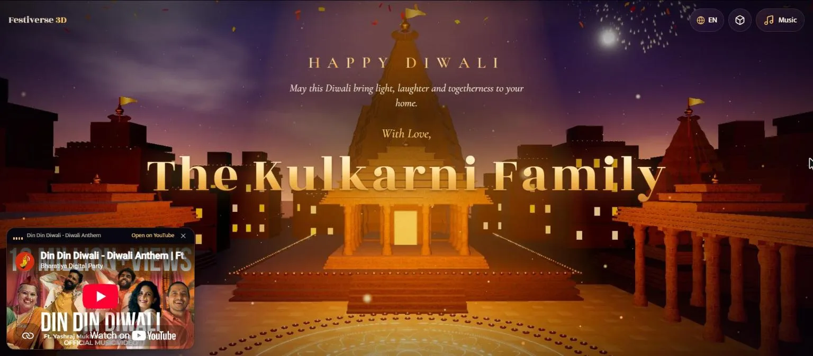
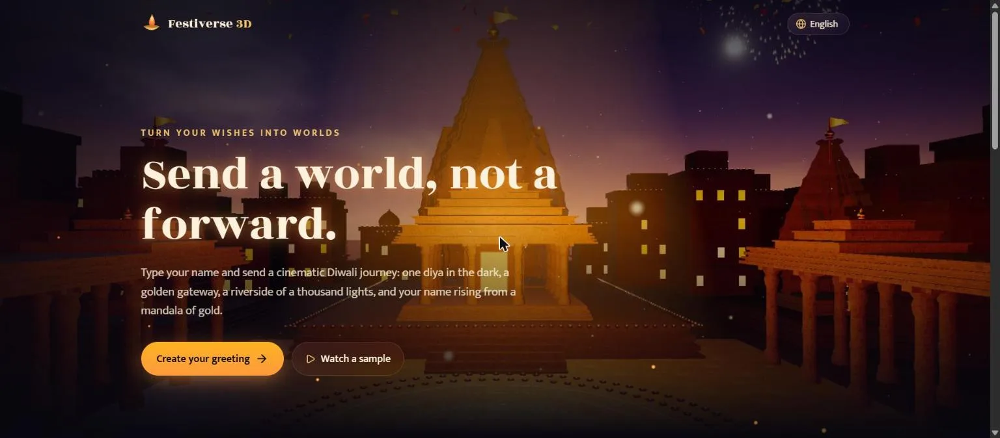
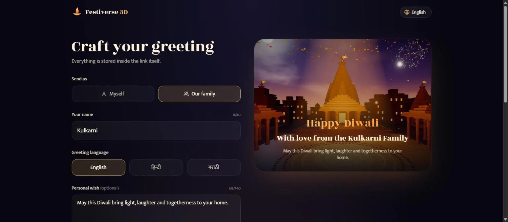
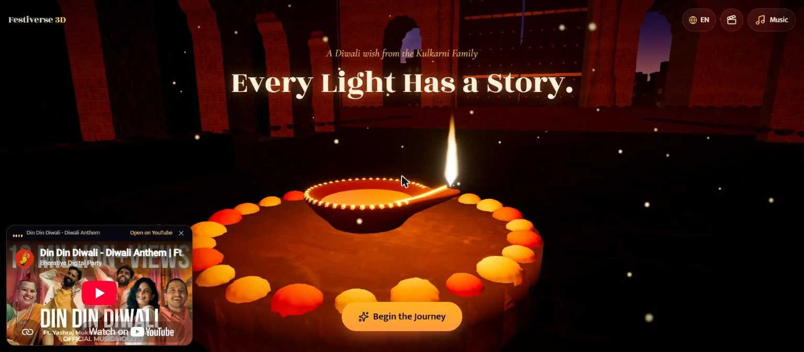
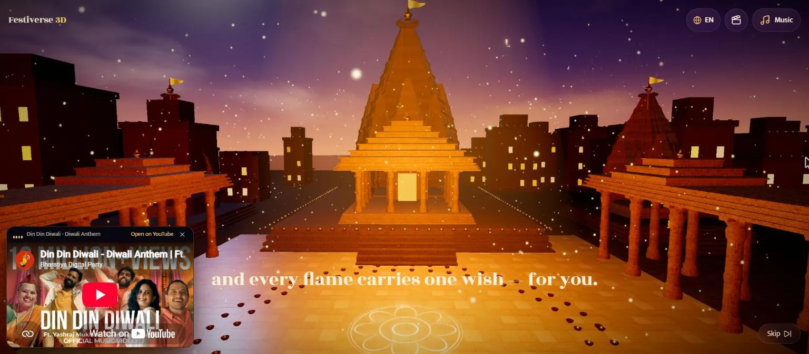
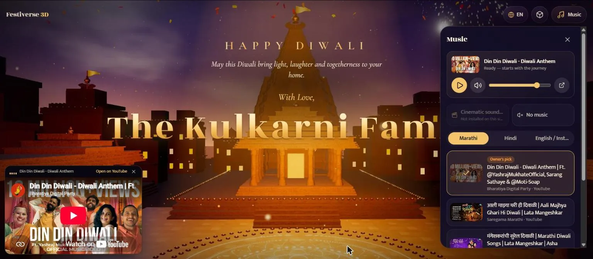
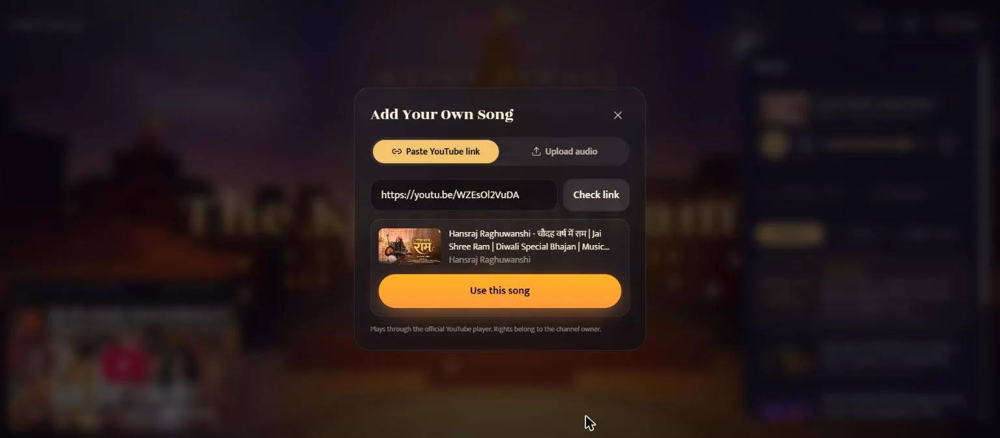
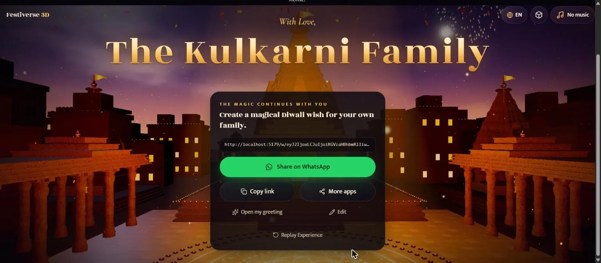
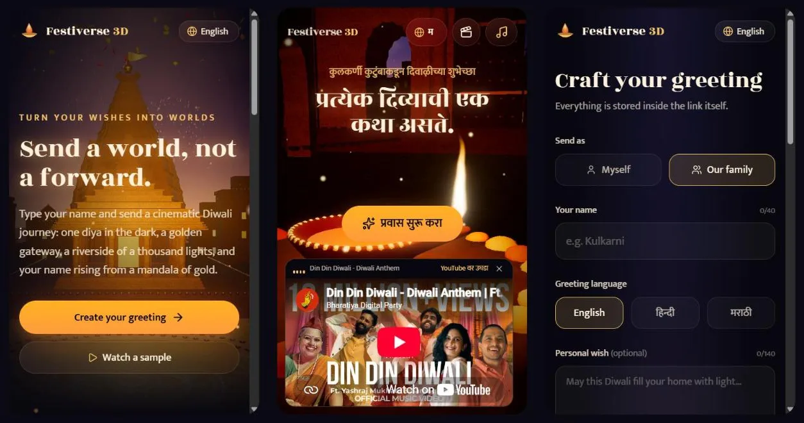

<div align="center">

# 🪔 FESTIVERSE 3D

### Turn a Diwali Wish into an Unforgettable Cinematic Experience.

A personalised, shareable **3D Diwali greeting**: one link carries your family name into a cinematic journey through an Ayodhya-inspired city of a thousand lamps, inspired by the celebration of Ayodhya Deepotsav.

[](LICENSE)


[Overview](#-overview) · [Features](#-features) · [Demo](#-live-demo) · [Screenshots](#-screenshots) · [Getting Started](#-getting-started) · [How It Works](#-how-festiverse-works) · [Architecture](#-architecture) · [Music](#-music-system) · [Performance](#-performance--benchmarking) · [Deployment](#-deployment-netlify) · [Contributing](#-contributing) · [License](#-license--credits)

<br/>



</div>

---

## 🌐 Live Demo

> **Deployment coming soon.** The project is ready for Netlify (see [Deployment](#-deployment-netlify)), but there is no public production URL yet. Until then, run it locally in about a minute with the steps in [Getting Started](#-getting-started).

---

## ✨ Overview

**Festiverse 3D** is a free, open-source web app for sending Diwali wishes that feel like an event, not a forward.

You type your name (or your family's name), choose a language, optionally add a personal wish and a song, and get a link. Whoever opens it is taken through a short **six-act cinematic journey**: a single diya in the dark, a golden gateway, a riverside where thousands of lamps ignite in a wave, and finally a temple courtyard where a golden mandala lights up and **your name rises as the centrepiece** of the greeting. The journey ends by inviting the recipient to create their own, so the wish keeps travelling.

**Why it was built.** Most festival greetings are a static image or a long forwarded message. Festiverse turns the greeting into a small world that is personal, beautiful and easy to share on WhatsApp, in Hindi, Marathi or English.

**What makes it different**

- 🎬 **A real-time 3D story, not a card.** Built with Three.js / React Three Fiber, with GPU-animated diyas, sky lanterns, fireworks and petals.
- 🔗 **No accounts, no database.** The whole greeting (name, language, wish, song choice) lives inside the link.
- 🪔 **Personal at its core.** The sender's name is the visual climax of the experience.
- 📱 **Phone-first.** Devices that struggle with 3D automatically get a lighter "cinematic film" version of the same story.
- 🧡 **Open source (MIT).** Free to use, study, self-host and improve.

---

## 🎁 Features

| Feature | What it does |
| --- | --- |
| **Personalised greetings** | The sender's name appears in the intro ("A Diwali wish from…"), the page title and the gold name reveal. |
| **Family or individual** | "Myself" or "Our family". Family greetings read *"The Kulkarni Family"* / *"कुलकर्णी परिवार"* / *"कुलकर्णी कुटुंब"*, and a typed "Family" suffix isn't doubled. |
| **Custom wishes** | An optional personal message (up to 140 characters) replaces the default blessing. |
| **Shareable links** | Each greeting is a URL like `/w/<payload>`, so there's nothing to store and nothing to log in to. |
| **Six-act Ayodhya journey** | Hero diya → golden gateway → riverside of lamps → mandala reveal → finale → create-your-own (see [The six acts](#-the-six-act-cinematic-journey)). |
| **3D world** | Procedurally built Nagara-style temples, an arched gateway with opening doors, ghats, a city with lit windows, instanced diyas, rising sky lanterns, a glowing mandala, GPU fireworks, falling petals, river reflections, fog and light shafts. |
| **Hindi · Marathi · English** | Full UI and greeting copy in all three languages. The recipient can switch language on the greeting itself. |
| **WhatsApp sharing** | One-tap **Share on WhatsApp**, **Copy link**, and the native share sheet where the browser supports it. |
| **Create your own** | The final act has a built-in generator, so recipients can make their own greeting without leaving the page. |
| **Responsive and mobile** | Layouts for phone, tablet and desktop. The music panel becomes a bottom sheet on phones. |
| **Lite mode (2.5D film)** | A lightweight version that plays the same acts over stills rendered from the 3D scene. It's the default for reduced motion, devices without WebGL and low-end devices, and you can switch modes at any time. |
| **Quality tiers** | `high` / `medium` / `low` budgets for lamps, houses, particles, lights and reflections, chosen per device and lowered automatically if the frame rate drops. |
| **Benchmark mode** | Add `?bench` to any greeting link to play the whole journey automatically and report per-act frame times. |
| **Music selection** | Curated Hindi, Marathi and English/Instrumental songs played through the **official YouTube player**, or **No music**. |
| **Your own YouTube song** | Paste a watch, `youtu.be`, Shorts, embed or live link. It's validated, and its real title and channel are shown before you use it. |
| **Local audio upload** | Play an MP3/WAV/M4A/OGG (≤ 25 MB) from your own device. It's never uploaded, and it only plays in that browser session. |
| **Music controls** | Play / Pause, Mute, Volume, Change song, + Add Your Own Song, No music, and an equaliser that only animates while audio is actually playing. |
| **No account needed** | No sign-up, no backend, no API keys. |

---

## 🖼 Screenshots

> All screenshots are real captures of this repository running locally (desktop Chrome; the phone views are 390 px-wide frames).

<table>
  <tr>
    <td width="50%"><br/><sub><b>Homepage</b>: "Send a world, not a forward."</sub></td>
    <td width="50%"><br/><sub><b>Greeting creator</b> with a live preview</sub></td>
  </tr>
  <tr>
    <td><br/><sub><b>Act I · The First Light</b>: "Every Light Has a Story."</sub></td>
    <td><br/><sub><b>The journey</b>: the courtyard as the mandala begins to glow</sub></td>
  </tr>
  <tr>
    <td><br/><sub><b>Name reveal</b>: HAPPY DIWALI · wish · "With Love," · the family name</sub></td>
    <td><br/><sub><b>Music player</b>: controls and the Marathi / Hindi / English collections</sub></td>
  </tr>
  <tr>
    <td><br/><sub><b>Add Your Own Song</b>: a YouTube link checked against its real title and channel</sub></td>
    <td><br/><sub><b>Act VI</b>: create your own, then Copy link / WhatsApp / Replay</sub></td>
  </tr>
  <tr>
    <td colspan="2"><br/><sub><b>On phones</b>: home, a Marathi greeting with the docked official YouTube player, and the creator</sub></td>
  </tr>
</table>

---

## 🧭 How Festiverse Works

### The user journey

1. **Visit** the homepage and tap **Create your greeting**.
2. **Enter your name** or family name and pick **Myself** or **Our family**.
3. **Choose a language**: English, हिन्दी or मराठी.
4. **Write an optional personal wish** (up to 140 characters).
5. **Choose a song**: the site soundtrack (if installed), a curated YouTube song, your own YouTube link, a local file (this device only), or **No music**.
6. **Create my link.** The greeting is encoded into a URL instantly, in your browser.
7. **Share it** on WhatsApp, copy the link, or use your phone's share sheet.
8. **The recipient opens the link**, taps **Begin the Journey**, and experiences the six acts with your name revealed in gold.
9. **The recipient creates their own** greeting in Act VI, and the wish travels on.

### No-database link architecture

There is no server-side storage. A greeting is a small JSON object that is **UTF-8 encoded, then [Base64URL](https://datatracker.ietf.org/doc/html/rfc4648#section-5) encoded** into the path:

```text
https://<your-site>/w/eyJ2IjoxLCJuIjoiS3Vsa2FybmkiLCJrIjoiZiIsInQiOiJhIiwibCI6ImVuIn0
                     └──────────── base64url( {"v":1,"n":"Kulkarni","k":"f","t":"a","l":"en"} ) ────────────┘
```

| Key | Meaning | Values |
| --- | --- | --- |
| `v` | payload version | `1` |
| `n` | sender name | up to 40 characters (counted as grapheme clusters) |
| `k` | sender kind | `i` individual · `f` family |
| `t` | world / theme | `a` Ayodhya (`r`, `c` from older links still open Ayodhya) |
| `l` | language | `en` · `hi` · `mr` |
| `m` | personal wish *(optional)* | up to 140 characters |
| `mu` | music *(optional)* | absent = site soundtrack · `n` = none · `y` = YouTube |
| `y`, `yt`, `ya` | YouTube video ID, title, channel *(only when `mu` = `y`)* | ID must match `^[A-Za-z0-9_-]{11}$` |

> [!IMPORTANT]
> **Base64URL is an encoding, not encryption.** Anyone who has a greeting link can decode it and read the name, wish and song. Don't put private or sensitive information in a greeting.

**Safety and robustness**
- All text is sanitised: control characters, bidi-override characters and `<` `>` are removed, whitespace is collapsed, and length is limited. React escapes everything it renders.
- Malformed, truncated or unknown-version links show a friendly **"This greeting link looks broken"** page with a *Create your own* button instead of crashing.
- An invalid music field is simply dropped; the greeting still opens.
- Legacy links whose payload is just a Base64 name (e.g. `/w/S2F0ZSBGYW1pbHk` → "Kate Family") are still accepted.

---

## 🎬 The Six-Act Cinematic Journey

Every visual cue (camera, lamps, doors, lanterns, mandala, fireworks, captions and music cues) reads one shared clock, defined in [`src/experience/timeline.ts`](src/experience/timeline.ts). Acts I–IV use the names shown on the homepage; Acts V and VI are named after their code comments and on-screen title.

| Act | Starts at | What you see |
| --- | --- | --- |
| **I · The First Light** | before you tap | Darkness and a single clay diya with a painted, dotted rim, a flickering flame and a ring of marigolds, with gold dust in the air. *"Every Light Has a Story."* Tapping **Begin the Journey** makes light spread along an arcaded road. |
| **II · The Golden Gateway** | 2.6 s | The camera approaches a carved sandstone gateway; its studded wooden doors swing open (4.6 s) and the camera passes through (8.2 s). *"Beyond the Golden Gateway…"* |
| **III · City of a Thousand Lights** *(homepage: "A Thousand Lights")* | 8.2 s | A low flight over the river. Thousands of diyas ignite in a wave across the ghats (8.8 s), city windows light up, sky lanterns rise (9.8 s), and the water reflects it all. |
| **IV · The Divine Reveal** | 15.8 s | In the temple courtyard a golden mandala draws itself (16.6 s), particles gather into it (17.2 s), and the greeting appears (20.4 s): **HAPPY DIWALI**, the wish, *"With Love,"* and the **name**. |
| **V · Grand Finale** | 21.2 s | Rocket-launched fireworks with trailing sparks and falling marigold and rose petals. Tap anywhere to launch a firework. |
| **VI · The Magic Continues** | 28 s | *"The Magic Continues With You"*: create your own greeting, Copy link, Share on WhatsApp, or Replay Experience. |

<details>
<summary><b>How the animation and the name reveal work</b></summary>

- **One clock.** `journey.t` is advanced by a single `requestAnimationFrame` loop on the greeting page. 3D components read it in `useFrame`, so nothing re-renders React every frame. **Skip** jumps the clock to just before the reveal, and **Replay** resets it.
- **Camera.** A Catmull-Rom spline through timed keyframes, eased at the start and end, with gentle drift and pointer parallax once the reveal settles.
- **Lamps on the GPU.** Each diya has an ignition time stored as a vertex attribute. A shader turns it on (with a small "catch" flare) as the clock passes, so the wave of thousands of lamps costs almost no CPU.
- **Name reveal.** `NameReveal` animates with GSAP from blur, offset and scale into place. Latin text animates per letter. Devanagari animates **per word**, so conjuncts such as क्ष or त्र are never split across animated spans, and words never break mid-line. Each letter carries its own gold gradient.
- **Reduced motion.** The camera flight is skipped (the journey starts at the reveal) and the reveal becomes a simple fade.

</details>

---

## 🎵 Music System

The music player is a floating gold-and-glass panel on desktop and a bottom sheet on phones. It offers **Play / Pause, Mute, Volume, Change song, + Add Your Own Song** and **No music**.

### Curated collections

All entries are uploads on the artist's, label's or broadcaster's **official YouTube channel**. Titles and channels were read from YouTube's oEmbed data, not typed by hand. They were verified on 2026-11-08, including a muted playback test in the embedded player on `localhost`. See [`src/lib/musicLibrary.ts`](src/lib/musicLibrary.ts).

| Collection | Songs (channel) |
| --- | --- |
| **Marathi** | ⭐ **Din Din Diwali – Diwali Anthem** *(Bharatiya Digital Party / BhaDiPa · owner's pick, listed first)* · Aali Majhya Ghari Hi Diwali – Lata Mangeshkar *(Saregama Marathi)* · मंगेशकरांची सुरेल दिवाळी *(Saregama Marathi)* · Din Din Diwali Song *(Zee Marathi)* |
| **Hindi** | चौदह वर्ष में राम / Chaudah Varsh Mein Ram *(Hansraj Raghuwanshi)* · Ram Ayodhya Aaye Hain – Kailash Kher *(Doordarshan National)* · Jalte Diye – Prem Ratan Dhan Payo *(Rajshri)* |
| **English / Instrumental** | Festive Indian Cinematic Instrumentals *(Alec Koff Label)* · Musical Diwali – Pt. Ravi Shankar & Ustad Bismillah Khan *(Saregama Hindustani Classical)* · Deepawali – Sounds of Isha, flute *(Sadhguru)* |

### Sources and how they play

| Source | Playback | Travels in the link? |
| --- | --- | --- |
| Curated or pasted **YouTube** song | The official YouTube **IFrame API** player (`youtube-nocookie.com`), docked and **visible** while a YouTube song is selected | ✅ video ID, title and channel only |
| **Local upload** (MP3, WAV, M4A, OGG · ≤ 25 MB) | In the browser from an object URL; never uploaded or stored; released when replaced or when the page closes | ❌ **No.** There is no server, so the link is shared without music, and the UI says so |
| **Site soundtrack** (`public/audio/soundtrack.mp3`) | Web Audio: fades in on *Begin*, lifts at the name reveal, fades out at the finale | ✅ (it's the default) |
| **No music** | – | ✅ |

**Add Your Own Song**
- **YouTube link:** accepts `watch?v=`, `youtu.be/`, `/shorts/`, `/embed/`, `/live/` and bare 11-character IDs, and rejects other domains and look-alike hosts. It then checks YouTube's public oEmbed endpoint and shows the real title, the channel, or a clear message for *invalid link*, *unavailable/private video* or *embedding disabled by the owner* (with an **Open on YouTube** button).
- **Upload:** checks the extension, MIME type, size, and whether this browser can actually decode the format (e.g. Safari can't play OGG). The visitor must confirm *"I own this audio or have permission to use it."*

**Playback rules**
- **Nothing autoplays.** Browsers block sound without a user gesture, so music starts when the recipient taps **Begin the Journey** (or Play). Some mobile browsers only allow a tap on the YouTube player itself; the app shows a hint when that happens.
- **YouTube is not synchronised to the acts.** Festiverse only calls the official player's play, pause, mute and volume controls. It never downloads, extracts, proxies or hides YouTube audio. The cinematic fades apply only to file audio.
- **Missing or unavailable videos** (removed, private, or embedding disabled) show *"This song can't play here"* with an **Open on YouTube** button.
- **No soundtrack file is shipped.** Until you add a licensed one, *Cinematic soundtrack* is shown as **not installed**.

> [!NOTE]
> **Copyright.** Festiverse does not own or redistribute third-party YouTube recordings. Embedded videos remain subject to YouTube's terms and the rights of their respective owners. They are **not** covered by this project's MIT license. User-uploaded local audio does not travel through shareable greeting links.

---

## 🛠 Technology Stack

| Technology | Purpose in Festiverse |
| --- | --- |
| [React 19](https://react.dev) + React DOM | UI, pages and state |
| [React Router 7](https://reactrouter.com) (`react-router-dom`) | Routes: `/`, `/create`, `/w/:payload`, and a not-found page |
| [TypeScript](https://www.typescriptlang.org) (strict) | Typing across app, scene and scripts |
| [Vite 8](https://vite.dev) + `@vitejs/plugin-react` | Dev server, production build and code splitting (the 3D scene loads lazily) |
| [Tailwind CSS 4](https://tailwindcss.com) (`@tailwindcss/vite`) | Styling and design tokens |
| [Three.js](https://threejs.org) | WebGL rendering, geometry and custom GLSL shaders |
| [@react-three/fiber](https://r3f.docs.pmnd.rs) | React renderer for Three.js |
| [@react-three/drei](https://drei.docs.pmnd.rs) | Textures and glTF loading, Stars, Environment/Lightformers, river reflections, PerformanceMonitor |
| [@react-three/postprocessing](https://react-postprocessing.docs.pmnd.rs) (and `postprocessing`) | Bloom, ACES tone mapping, colour grade, vignette and grain |
| [GSAP](https://gsap.com) | Letter-by-letter name and title reveals |
| [Lucide React](https://lucide.dev) | Icons |
| [Vitest](https://vitest.dev) + jsdom | Unit tests |
| [sharp](https://sharp.pixelplumbing.com) · [glTF Transform](https://gltf-transform.dev) *(dev only)* | Asset scripts: WebP textures and stills, GLB optimisation |
| YouTube IFrame Player API · YouTube oEmbed *(runtime, external)* | Official embedded playback and song title/channel lookup |
| Google Fonts *(runtime, external)* | Rozha One, Mukta, Cormorant Garamond |

---

## 🏗 Architecture

```text
Festiverse-/
├── index.html                    # App shell, meta/OG tags, fonts
├── netlify.toml                  # Build, SPA redirect, headers, optional edge function
├── netlify/edge-functions/
│   └── greeting-meta.ts          # Optional: puts the sender's name in the link-preview title
├── public/
│   ├── models/lantern.glb        # CC0 Brass Diya Lantern (Poly Haven), optimised
│   ├── textures/*.webp           # CC0 PBR textures (sandstone, pavement, marble, clay plaster)
│   ├── stills/*.webp             # Stills rendered from the 3D scene (Lite mode + homepage)
│   ├── og-image.jpg              # Link-preview image (a render of the scene)
│   ├── favicon.svg · manifest.webmanifest
├── scripts/
│   ├── fetch-assets.mjs          # Re-downloads and converts the CC0 assets
│   ├── encode-stills.mjs         # Converts captured stills to WebP and builds og-image.jpg
│   └── capture-stills.md         # How to render stills from the live scene (dev only)
├── docs/screenshots/             # README screenshots
└── src/
    ├── main.tsx · App.tsx        # Entry and routes (Create and Greeting pages are lazy-loaded)
    ├── pages/                    # HomePage, CreatePage, GreetingPage, NotFoundPage
    ├── experience/               # The 3D world
    │   ├── timeline.ts           #   act times, camera keys, shared journey clock
    │   ├── kit.ts                #   procedural architecture (spires, amalaka, arches, columns…)
    │   ├── Architecture.tsx      #   temples, gateway, arcades, ghats, courtyard, city
    │   ├── Lights.tsx            #   diya fields, hero diya + flame shader, brass lanterns
    │   ├── Atmosphere.tsx        #   sky, fog sheets, light shafts, river
    │   ├── Effects.tsx           #   fireworks, sky lanterns, mandala, particles, petals, dust
    │   ├── materials.ts          #   PBR materials
    │   └── DivineReturn.tsx      #   scene root, quality tiers, camera director
    ├── components/
    │   ├── three/GreetingCanvas.tsx   # Canvas, post-processing, tap-to-firework, fallbacks
    │   ├── music/                # MusicPlayer (panel + YouTube dock), SongPicker, AddSongModal
    │   └── ui/                   # CinematicFilm (Lite mode), NameReveal, SharePanel, BenchOverlay…
    ├── lib/                      # greeting codec, music engine, YouTube helpers, song library,
    │                             # device tiering, share helpers, storage, config
    └── i18n/                     # en / hi / mr strings and provider
```

**Key ideas**
- **Code splitting.** The homepage loads only the app shell. The greeting page and its three.js chunk load lazily, and the 3D scene keeps loading while Act I is on screen.
- **Procedural architecture.** We found no redistributable Indian-temple 3D models (see [ASSETS.md](ASSETS.md)), so temples, gateway and city are generated from Nagara-style rules (stepped plans, curvilinear spires with banding, ribbed amalaka, kalash, multi-foil arches). They're merged into a few draw calls and textured with real CC0 stone.
- **Fallbacks everywhere.** WebGL context loss, a render error, or a sustained low frame rate all switch the visitor to Lite mode instead of a blank page.

---

## 🚀 Getting Started

### Prerequisites

- **Node.js 22** (Netlify builds with Node 22; development was also done on Node 24). `package.json` doesn't pin an engine; Vite 8 needs Node 20.19+ or 22.12+.
- **npm** (comes with Node)
- **Git**

### Install and run

```bash
git clone https://github.com/HarshvardhanL02/Festiverse-.git
cd Festiverse-
npm install
npm run dev          # http://localhost:5173
```

### All scripts (from `package.json`)

| Command | What it does |
| --- | --- |
| `npm run dev` | Start the Vite dev server |
| `npm run build` | Type-check (`tsc -b`) and build for production into `dist/` |
| `npm run preview` | Serve the production build locally |
| `npm test` | Run all unit tests once (Vitest) |
| `npm run typecheck` | Type-check only (`tsc -b`) |

Tests cover the link codec and sanitising, music links, YouTube URL parsing and metadata states, upload validation, the song library, i18n key parity across the three languages, the geometry kit (no NaN normals), the act timeline and benchmark statistics.

<details>
<summary><b>Optional asset scripts</b></summary>

```bash
node scripts/fetch-assets.mjs     # re-download CC0 textures + lantern from Poly Haven (needs network)
node scripts/encode-stills.mjs    # after capturing stills (see scripts/capture-stills.md)
```

The generated assets are already committed, so a normal install and build doesn't need these scripts.

</details>

---

## ⚙️ Configuration

**No environment variables are required.** These are optional and set at build time (e.g. in a `.env.local` file or the Netlify UI):

| Variable | Required | Purpose |
| --- | --- | --- |
| `VITE_REPO_URL` | Optional | Shows a "Source code" link in the homepage footer. Hidden when unset. |
| `VITE_SOUNDTRACK_URL` | Optional | URL of the site soundtrack (default `/audio/soundtrack.mp3`). |

> [!WARNING]
> Every `VITE_*` variable is **embedded in the public JavaScript bundle**. Never put secrets, tokens or private URLs in them. Festiverse needs no API keys.

**Adding a soundtrack:** place a track you own or have licensed at `public/audio/soundtrack.mp3` and rebuild. The app detects it automatically, and "Cinematic soundtrack" becomes selectable.

---

## 📊 Performance & Benchmarking

### Quality tiers

| Tier | Chosen when | What changes |
| --- | --- | --- |
| `high` | Desktop-class devices | All lamps, about 260 houses, planar river reflections, film grain, 8 key lights |
| `medium` | Phones, ≤ 4 GB memory or ≤ 4 CPU cores | About half the lamps and particles, no reflections, 4 lights |
| `low` | No WebGL, Save-Data, ≤ 2 GB memory or ≤ 2 cores | Starts in **Lite mode** by default; minimal 3D budgets if 3D is chosen |

At runtime, drei's `PerformanceMonitor` lowers the pixel ratio and tier when frames drop, and switches to Lite mode if the frame rate collapses.

### Benchmark mode (`?bench`)

Add `?bench` to **any greeting link**. The journey starts by itself once loaded and plays through all six acts. At the end, an on-screen panel reports, **per act**:

- **Average FPS**
- **p95 frame time**: the frame time that the slowest 5% of frames meet or exceed
- **Worst frame time**
- Device info: tier, Lite/3D mode, device pixel ratio, viewport, GPU renderer string, user agent

Results can be copied with **Copy results** and are also logged to the console (`[festiverse bench]`). Automatic tier downgrades are disabled during a benchmark, so each run measures exactly one tier.

```text
http://localhost:5173/w/eyJ2IjoxLCJuIjoiS3Vsa2FybmkiLCJrIjoiZiIsInQiOiJhIiwibCI6ImVuIn0?bench
http://localhost:5173/w/eyJ2IjoxLCJuIjoiS3Vsa2FybmkiLCJrIjoiZiIsInQiOiJhIiwibCI6ImVuIn0?bench&tier=medium
http://localhost:5173/w/eyJ2IjoxLCJuIjoiS3Vsa2FybmkiLCJrIjoiZiIsInQiOiJhIiwibCI6ImVuIn0?bench&mode=film
```

- `tier=high|medium|low` pins the quality tier.
- `mode=film` benchmarks Lite mode instead of 3D.
- **Desktop:** keep the browser window visible and in front (background or covered windows are throttled).
- **Phone:** run `npm run build && npx vite preview --host`, then open `http://<your-PC's-LAN-IP>:4173/w/…?bench` on the phone (same Wi-Fi).

> [!CAUTION]
> **Performance has not yet been measured on real devices.** No benchmark results are published here. The build is about 95 KB gzipped of JS for the homepage. The 3D greeting adds about 330 KB gzipped of JS, plus about 1.3 MB of textures and a 295 KB model, loaded while Act I is shown.

---

## ♿ Accessibility & Mobile Support

What's implemented (no formal WCAG audit has been done, so no compliance is claimed):

- **Reduced motion:** with `prefers-reduced-motion`, Lite mode is the default, the camera flight is skipped, reveals become fades, and CSS animations are disabled.
- **No WebGL / failures:** the app detects missing WebGL, context loss, render errors and collapsing frame rates, and falls back to Lite mode.
- **Lite mode** can be switched on or off from the greeting's top bar at any time; the choice is remembered on that device.
- **Keyboard and screen readers:** real `<button>`/`<a>` controls, visible focus rings, `aria-label`s on icon buttons, `aria-pressed` on toggles, `aria-live` status for music and link results, and `role="dialog"` with Escape-to-close for the music panel and song modal.
- **Language:** `lang` is set on the document for correct pronunciation and font shaping, and the UI language follows your browser or your choice.
- **Mobile layout:** safe-area padding, a bottom-sheet music panel that sits above the docked YouTube player, and captions and buttons that move up so the player is never covered.

---

## ☁️ Deployment (Netlify)

Everything Netlify needs is in [`netlify.toml`](netlify.toml).

1. Push the repository to GitHub (already done for this repo).
2. In Netlify: **Add new site → Import an existing project → GitHub →** select `Festiverse-`.
3. Build settings are read from `netlify.toml`:

   | Setting | Value |
   | --- | --- |
   | Build command | `npm run build` |
   | Publish directory | `dist` |
   | Node version | `22` (`NODE_VERSION`) |

4. *(Optional)* Add `VITE_REPO_URL` / `VITE_SOUNDTRACK_URL` under **Site configuration → Environment variables**.
5. Deploy. Alternatively, use the CLI: `npx netlify-cli deploy --prod --build`.

**What `netlify.toml` already handles**
- **SPA redirect:** `/* → /index.html` (status 200), so deep links such as `/create` and every `/w/<payload>` greeting work on refresh and when shared.
- **Caching and headers:** long-term immutable caching for `/assets/*`, plus `X-Content-Type-Options`, `Referrer-Policy` and a restrictive `Permissions-Policy`.
- **Optional Edge Function:** [`netlify/edge-functions/greeting-meta.ts`](netlify/edge-functions/greeting-meta.ts) runs on `/w/*` and rewrites `<title>` and `og:title` so WhatsApp link previews say, e.g., *"The Sharma Family sent you a Diwali world ✨"* in the greeting's language. To disable it, delete the `[[edge_functions]]` block. It hasn't been tested on a live Netlify deploy yet.

---

## 🤝 Contributing

Contributions of every size are welcome: bug fixes, translations, accessibility, performance, docs and new ideas. Please read **[CONTRIBUTING.md](CONTRIBUTING.md)**.

```bash
# 1. Fork on GitHub, then:
git clone https://github.com/<your-username>/Festiverse-.git
cd Festiverse-
npm install

# 2. Create a feature branch
git checkout -b feat/short-description

# 3. Make changes, then verify
npm run typecheck
npm test
npm run build

# 4. Commit, push and open a Pull Request against main
git push origin feat/short-description
```

### 🗺 Roadmap (planned, not yet built)

- [ ] Public production deployment
- [ ] Real-device performance results (Android mid-range, iPhone, desktop) from `?bench`
- [ ] A licensed or original cinematic soundtrack for the default music slot
- [ ] KTX2/Basis-compressed textures for faster mobile loading
- [ ] Higher-fidelity, properly licensed architectural models
- [ ] More festivals and worlds (the link format already carries a theme field)
- [ ] More languages

---

## 📜 License & Credits

**Code:** [MIT License](LICENSE) © Festiverse 3D contributors.

**Third-party assets** (details in [ASSETS.md](ASSETS.md)):
- **[Poly Haven](https://polyhaven.com)**, CC0: *Brass Diya Lantern* (by Bhargav Kubal), *Red Sandstone Wall*, *Red Sandstone Pavement*, *Marble 01*, *Clay Plaster*.
- **Fonts:** Rozha One, Mukta and Cormorant Garamond via Google Fonts (SIL Open Font License 1.1).
- **Music:** all songs in the library belong to their respective artists, labels and channels: Bharatiya Digital Party (BhaDiPa), Saregama Marathi, Zee Marathi, Hansraj Raghuwanshi, Doordarshan National, Rajshri, Alec Koff Label, Saregama Hindustani Classical and Sadhguru / Sounds of Isha. They play only through YouTube's official embedded player and are **not** part of this repository or its license.
- **Open-source libraries:** React, React Router, Three.js, pmndrs (React Three Fiber, drei, postprocessing), GSAP, Lucide, Tailwind CSS, Vite, Vitest and others listed in `package.json`, each under its own license.

Everything else (procedural architecture, shaders, effects, stills and the link-preview image) was created for this project.

---

## 👤 Author

**Harshvardhan Lokhande**

- GitHub: [@HarshvardhanL02](https://github.com/HarshvardhanL02)
- Repository: [github.com/HarshvardhanL02/Festiverse-](https://github.com/HarshvardhanL02/Festiverse-)

<div align="center">
<br/>

**Made with ❤️ and the spirit of Diwali.**

🪔 शुभ दीपावली · दीपावलीच्या हार्दिक शुभेच्छा · Happy Diwali 🪔

</div>
